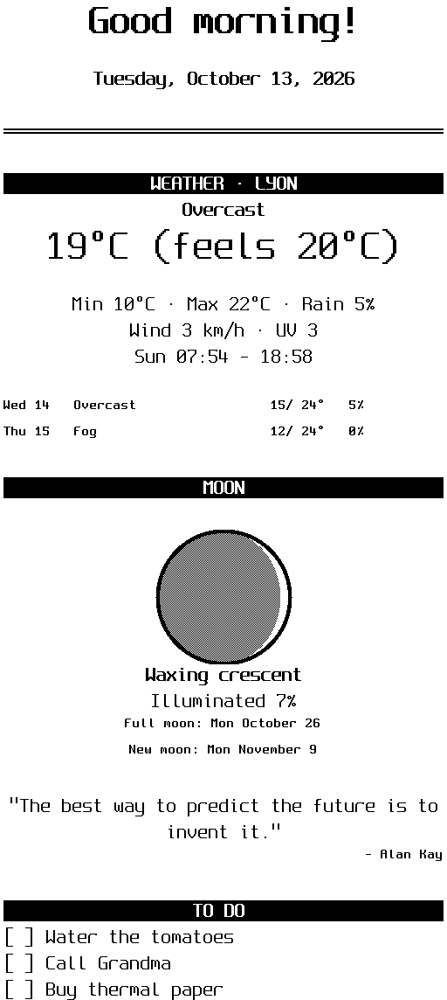
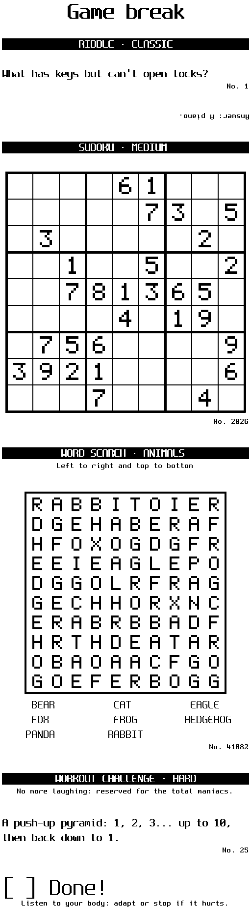
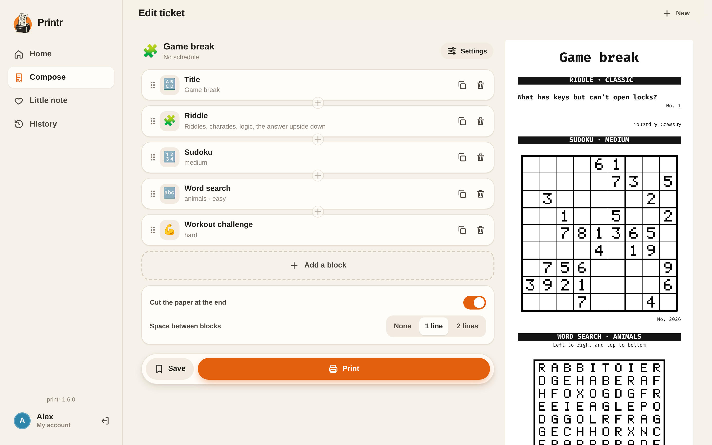
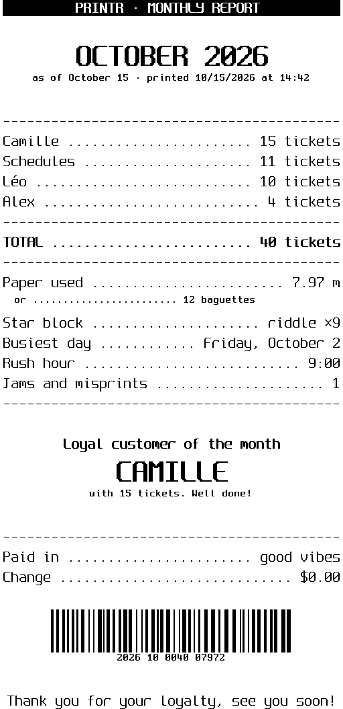
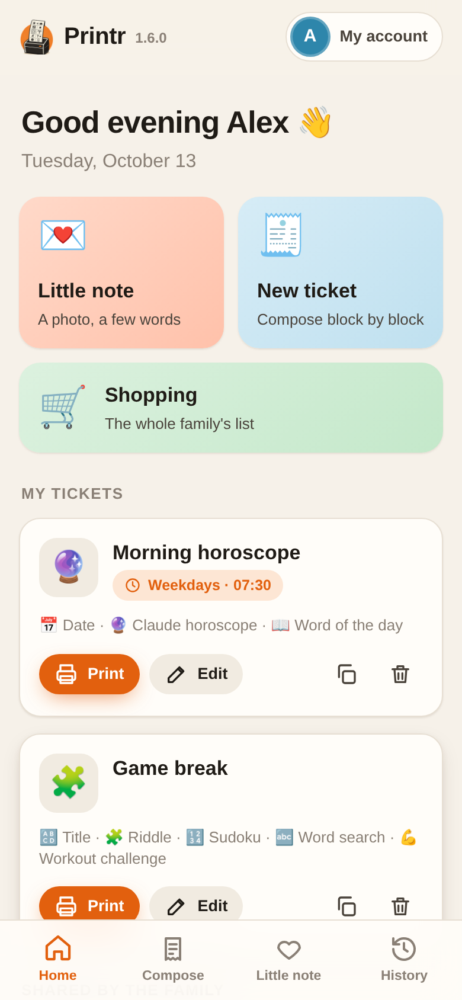
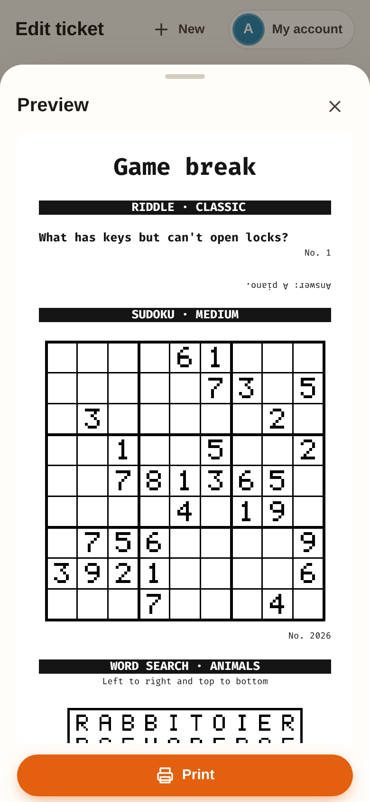
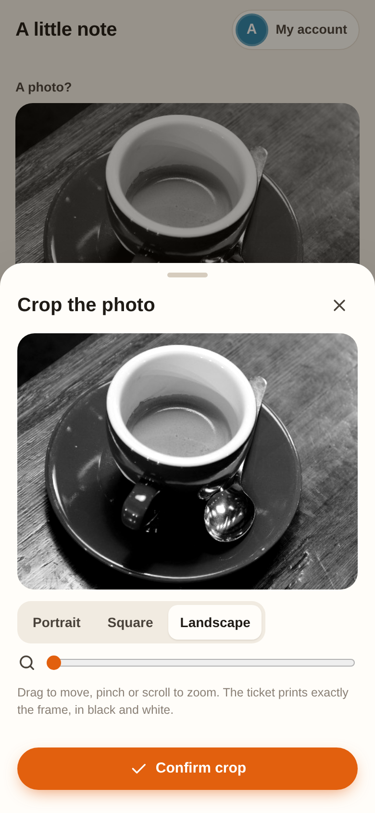

<p align="center">
  <picture>
    <source media="(prefers-color-scheme: dark)" srcset="docs/logo-dark.png">
    
  </picture>
</p>

<p align="center"><strong>Little receipts that do you good, every morning.</strong></p>

<p align="center">
  <a href="https://xninety9.github.io/Printr/"></a>
  
  
  
</p>

<p align="center">
  <a href="https://xninety9.github.io/Printr/">Site</a> ·
  <a href="#json-tickets">Blocks</a> ·
  <a href="#web-interface">The app</a> ·
  <a href="#installation">Install</a>
</p>

<p align="center"><a href="README.fr.md">🇫🇷 Version française</a></p>

Printr turns an **Epson TM-T88V** receipt printer into a family gadget. You compose a ticket from
**40 blocks** (weather, horoscope, sudoku, word search, riddles, news, photos…), print it from your
phone, **schedule** it for 7:30 on weekdays, or send a **little note with a photo** to the people
who stayed home. A single Rust binary, running on a Raspberry Pi, that speaks ESC/POS directly to
the printer.

<p align="center">
  
  &nbsp;
  
  &nbsp;
  
</p>

- **40 blocks**: weather, calendar, horoscope (serious, whimsical, snarky or downright insulting),
  word of the day, arrow words, sudoku, nonogram, word search, Categories, coloring, riddles
  with their answer printed upside down, workout challenge, shopping list, bin collection days,
  guest Wi-Fi, gift coupons, a receipt-style monthly report, news from RSS feeds, photos…
- **A web app for the family**: accounts, saved and shared tickets, live preview,
  scheduling in 24-hour format, history.
- **Lean**: almost everything is computed locally or comes from free APIs that need no key. Claude
  only writes the horoscope and the word of the day (one small call to Claude Haiku, cached for
  the day).
- **A tidy CLI**: preview in the terminal, progress block by block, readable errors.

<p align="center">
  <picture>
    <source media="(prefers-color-scheme: dark)" srcset="docs/shots/en/desktop-compose-dark.png">
    
  </picture>
</p>

## Quick start

```sh
export PRINTR_LANG=en                                          # English app and tickets (French by default)
cargo run --release -- --preview print examples/complet.json   # preview in the terminal, no printer needed
cargo run --release -- --device /dev/usb/lp0 serve             # interface at http://localhost:8080
scripts/deploy.sh pi@printer.local                             # install on a Raspberry Pi (or --local)
```

On first launch, the interface asks you to create your account, then the accounts of the family.

No printer yet? `scripts/demo.sh` prints the full ticket in an
[emulator](#testing-without-a-printer-emulator) and gives you a PNG image of it.

## The horoscope, in four tones

Written every day by Claude, on a theme picked at random. Real excerpts (translated from the
French output):

| Tone | Sign | Excerpt |
| --- | --- | --- |
| `serieux` | Scorpio | "A frank conversation will clear up a misunderstanding that has been weighing on you for several days." |
| `farfelu` | Gemini | "A particularly elegant pigeon may greet you with a nod of the head: return the courtesy, it is very influential in the neighborhood." |
| `vachard` | Virgo | "Your partner dreams of a romantic dinner. Nothing is more sensual than a kitchen scale placed between two candles." |
| `insultant` | Leo | "Your brand-new sneakers, still as stiff as a notary, are wondering what they ever did to the good Lord to end up with such a slacker." |

## Usage

```sh
printr print examples/matin.json    # ticket made of blocks (see below)
cat ticket.json | printr print      # same, from standard input
printr --preview print ticket.json  # preview in the terminal, nothing printed
printr --refresh print ticket.json  # regenerates what is cached: sun, horoscopes, word of the day
printr -q print ticket.json         # quiet, only shows errors
printr test                         # test ticket (styles, accents, QR code)
printr text "Hi there!"             # free text, then a cut
echo "from stdin" | printr text     # reads standard input
printr text --no-cut "no cut"
printr image photo.jpg              # image scaled down to 512 px, dithered (Floyd–Steinberg)
printr image --no-dither logo.png   # plain black-and-white threshold, for logos and line drawings
```

Destination, your choice:

| Option | Destination |
| --- | --- |
| `--device <path>` | USB printer (default `/dev/usb/lp0`, or `$PRINTR_DEVICE`) |
| `--tcp host:port` | network printer or emulator |
| `--dump <file>` | writes the raw ESC/POS bytes to a file |

## JSON tickets

A ticket is a list of blocks. Blocks are built in parallel (network requests included), and each
result appears in the CLI as soon as it is ready; the ticket is then printed in the defined order.
A block that fails prints an error message instead of blocking the ticket. An unknown parameter is
an error, so typos get caught.

```json
{
  "cut": true,
  "spacing": 1,
  "blocks": [
    { "type": "title", "text": "Hello!" },
    { "type": "weather", "location": "Lyon", "days": 3 },
    { "type": "horoscope", "sign": "scorpion", "tone": "farfelu" }
  ]
}
```

| Block | Parameters (default) | Notes |
| --- | --- | --- |
| `title` | `text`, `size` (2) | Bold, centered, enlarged |
| `text` | `text`, `bold`, `underline`, `reverse`, `small`, `size` (1), `align` (`left`/`center`/`right`) | Word-wrapped |
| `separator` | `style` (`-`) | One character repeated: `-`, `=`, `═`, `─`, `·`… |
| `date` | — | e.g. "Wednesday, October 7, 2026" |
| `feed` | `lines` (1) | Vertical space |
| `image` | `path` or `url`, `dither` (true) | Scaled down to 512 px |
| `qr` | `data`, `size` (6), `caption` | |
| `weather` | `location`, `days` (1, max 7) | [Open-Meteo](https://open-meteo.com), no key. `location`: a city or `"lat,lon"` |
| `barnum` | `sign` or `birth_date` (`YYYY-MM-DD`), `sky` (false), `variant` | Free offline horoscope, computed from the real sky by [Barnum](https://github.com/XNinety9/Barnum): gauges per area, advice, and optionally the position of the planets |
| `horoscope` | `sign`, `tone` (`serieux`/`farfelu`/`vachard`/`insultant`) | Generated by Claude, on a random theme. Sign in French or English |
| `saint` | — | Name day from the local calendar, offline |
| `todo` | `items`, `title` ("To do") | Checkboxes |
| `sudoku` | `difficulty` (`facile`/`moyen`/`difficile`), `seed`, `solution` | The number printed is the seed: same `seed` + `"solution": true` prints the solution |
| `word_search` (or `mots_meles`, `mots_caches`, `mots_en_grille`) | `difficulty` (`facile`/`moyen`/`difficile`), `theme`, `words`, `seed`, `solution` | Word search in French. `theme`: `animaux`, `fruits_legumes`, `cuisine`, `nature`, `sport`, `metiers`, `maison`, `voyage`, `musique`, `ecole`, `developpement`, `devops`, `reseaux`, `ia` (picked from the number if absent); or your own words in `words`. Easy: 10×10, 8 words, → ↓; medium: 12×12, 12 words, plus diagonals; hard: 14×14, 16 words, in every direction. Same number + `"solution": true` prints the solution |
| `train_tracks` (or `voie_ferree`, `rails`) | `difficulty` (`facile`/`moyen`/`difficile`), `seed`, `solution` | Connect A (left edge) to B (bottom edge) with a single track, based on the number of track cells in each row and column and a few pieces already placed. Grids of 6×6, 8×8 and 10×10, each with a unique solution. Same `seed` + `"solution": true` prints the solution |
| `arrow_word` (or `mots_fleches`) | `level` (1 to 4, default 2), `size` (`petit`/`moyen`/`grand`: 7×9, 9×11, 11×13), `seed`, `solution` | Arrow words generated by [CrossWords](https://github.com/XNinety9/CrossWords): a numbered grid, with the clues written by Claude below it at print time. Same number, size and level + `"solution": true` prints the solution |
| `maze` | `width` (12), `height` (16), `seed` | |
| `word_of_the_day` | — | Picked by Claude, without repeating the last 60 words |
| `quote` | — | Quote of the day, from a local list |
| `holidays` | `zone` (`metropole`/`alsace-moselle`), `count` (1) | Computed locally, checked against calendrier.api.gouv.fr |
| `countdown` | `label`, `date` (`YYYY-MM-DD`) | "J-79 before: Christmas" |
| `moon` | — | Phase, illumination, next full and new moons. Computed locally |
| `on_this_day` | `count` (3) | "On this day" entries, from French Wikipedia |
| `air_quality` | `location` | European air quality index, particles, pollen (Open-Meteo) |
| `crypto` | `coins` (`["bitcoin", "ethereum"]`, CoinGecko IDs), `currency` (`eur`) | Prices and 24-hour change |
| `sun` | `location` | Sunrise, sunset and day length via Open-Meteo, no key |
| `riddle` (or `enigme`) | `kind` (`devinette`/`charade`/`logique`/`calcul`), `number`, `answer` (`envers`/`lendemain`/`dessous`/`aucune`) | 125 riddles, one per day, never repeated. By default the answer is printed upside down: turn the ticket over to read it |
| `workout` (or `defi_sportif`) | `level` (`facile`/`moyen`/`difficile`), `number` | Workout challenge of the day, no equipment needed, 25 challenges per level |
| `news` | `title`, `feeds` (RSS/Atom URLs), `count` (3, max 5), `qr` (2, max 2), `themes`, `exclude`, `max_age_hours` (24) | News digest without AI: see below |
| `petit_bac` | `players` (1), `letter`, `count` (6), `categories`, `seed` | Categories: one letter and a set of categories, one sheet per player, all with the same letter |
| `mental_math` (or `calcul_mental`) | `difficulty` (`facile`/`moyen`/`difficile`), `count` (10), `seed` | Sheet of arithmetic problems, answers printed upside down |
| `anagram` (or `mot_mystere`) | `theme` (as in `word_search`), `count` (3), `seed` | Scrambled letters, with the theme and length as hints; answers upside down |
| `nonogram` (or `logimage`) | `number` (1 to 10), `solution` | 10×10 nonogram; each picture has a unique solution, findable by deduction (checked by the tests) |
| `cipher` (or `message_code`) | `message`, `cipher` (`cesar`/`morse`/`nombres`), `shift`, `answer` (true) | Coded message and its decoding grid; random message if absent |
| `coloring` (or `coloriage`) | `seed` | Mandala to color, different for each number |
| `coupon` (or `bon`) | `text`, `from`, `to`, `valid_until`, `count` (1) | "Good for…" gift coupon with a border strip, serial number and cut line; random idea if `text` is absent |
| `shopping` (or `courses`) | `title`, `clear` (false) | The app's shared shopping list; with `clear`, the server empties it once printed |
| `agenda` | `calendars` (ICS links or `webcal://`, or files), `days` (1, max 7), `title` | Today's appointments, recurring events and time zones included |
| `bins` (or `poubelles`) | `collections` (`name`, `days`, `every`, `from`), `when` (`veille`/`jour`), `always` | "Tonight, put the yellow bin out"; nothing is printed on evenings without collection, unless `always` is set |
| `wifi` | `ssid`, `password`, `security` (`wpa`/`wep`/`none`), `hidden`, `show_password` (true) | QR code that connects straight to the network |
| `monthly_report` (or `bilan`) | `month` (`YYYY-MM`, current month by default) | Receipt-style monthly report, drawn from the app's history |

Each block has an example in [`docs/exemples/`](docs/exemples/): the JSON ticket and its rendering,
regenerated by `docs/exemples/generer.sh` (dummy data). They are all shown as pictures on the
[blocks page](https://xninety9.github.io/Printr/blocs.html) of the website.

<p align="center">
  
  &nbsp;
  
  &nbsp;
  
</p>

Bin collection example, with the yellow bin every other Friday:

```json
{ "type": "poubelles", "collections": [
  { "name": "household waste", "days": ["lundi", "vendredi"] },
  { "name": "yellow bin", "days": ["vendredi"], "every": 2, "from": "2026-10-09" }
] }
```

### News (`news`)

The block reads the RSS or Atom feeds you give it, without AI, for free and in under a second.
Articles are ranked by:

- the requested **themes**: found in the title (the strongest match), in the URL's section, in the
  categories, or in the summary. A theme matches at the start of a word ("climat" finds
  "climatique"; the feeds are in French, so the example themes are too);
- their **position in the feed** (the newsroom's front page first);
- **cross-coverage**: a topic covered by several feeds moves up;
- their **freshness** (beyond `max_age_hours`, the article is dropped).

Live streams, videos, podcasts and opinion pieces are dropped, as are articles containing a word
from `exclude`. Two articles on the same subject are never kept together. The first `qr` articles
get a QR code, two per line. `PRINTR_DEBUG=1` shows the full ranking.

```json
{ "type": "news", "title": "France",
  "feeds": ["https://www.franceinfo.fr/titres.rss", "https://www.lemonde.fr/rss/une.xml"],
  "themes": ["climat", "sciences", "santé"], "exclude": ["football"] }
```

The `barnum` block calls [Barnum](https://github.com/XNinety9/Barnum) on the command line:
`barnum` if it is installed, otherwise the command given in `PRINTR_BARNUM`, for example
`PRINTR_BARNUM="python3 /opt/barnum/main.py"` (Barnum only needs Python 3.10).

Every now and then (one print in twenty), the machine slips a strange message into the ticket,
with no header, like printed noise: this is the **glitch**. `PRINTR_GLITCH` sets how often it
happens (`PRINTR_GLITCH=5` for one in five, `0` for never); `{ "type": "glitch" }` forces one.
It never appears in previews.

The `arrow_word` block relies on the [CrossWords](https://github.com/XNinety9/CrossWords) library
(Apache 2.0, © 2026 Pierre, [XNinety9](https://github.com/XNinety9); see [`NOTICE`](NOTICE)).
On first use, it downloads its word list with `curl` (about thirty seconds, only once) into
printr's cache.
Definitions come from its cache (`crosswords/definitions.txt`, or `definitions-en.txt` in
English), completed at print time by Claude
for the words it does not know: less than a cent per new grid at levels 1 and 2 (Claude Haiku),
about ten cents at levels 3 and 4 (Claude Opus). Previews never call Claude, and a word that
Claude could not define is not asked for again: its length is printed instead.

The `horoscope` and `word_of_the_day` blocks use the Claude API: set `ANTHROPIC_API_KEY` (and
optionally `PRINTR_CLAUDE_MODEL`, `claude-haiku-5-5` by default).

Date-dependent content is **cached**: reprinting the same ticket gives the same results, without
a new API call. `--refresh` forces a new generation. The cache lives in `~/.cache/printr` (or
`$PRINTR_CACHE_DIR`, or `/var/cache/printr` with the systemd service). `PRINTR_DEBUG=1` shows the
raw API responses.

## Language

Printr speaks French by default. Setting `PRINTR_LANG=en` (in `/etc/printr.env` for the service)
switches the whole installation to English: the web interface, the command line, messages and
tickets. Blocks with content (riddles, quotes, word searches, workouts, gift coupons…) have their
own English list, and Claude writes the horoscope and the word of the day in English.

**Arrow words** come from CrossWords' English dictionary, with English clues (its
`definitions-en.txt` cache, completed by Claude). The offline **Barnum horoscope** is written in
English too, with Barnum 0.3 or later (an older Barnum prints it in French). Only the **name day**
stays in French, for lack of an English source; **public holidays** are the French ones, named in
English.

## Web interface

`printr serve` serves a web interface designed for phones as well as computers:

<p align="center">
  
  &nbsp;
  
  &nbsp;
  
</p>

- **Compose**: add blocks (at the end or between two others), adjust them, and reorder them by
  dragging their handle, with a live preview of the ticket.
  Claude blocks (horoscope, word of the day) don't call the API in preview: they only cost
  something when printed.
- **My tickets**: saved tickets (presets), printed in one tap, shared with the family, and
  **scheduled** (days and time). A missed schedule more than 15 minutes late is not caught up.
- **Little note**: a photo taken with the phone, a drawing (heart, star…), a few words.
- **Shopping**: the family's shared list. Everyone adds what is missing, and it gets printed on the
  way out (then it empties itself). An iOS shortcut can also add items to it with
  `POST /api/shopping` and the token.
- **History**: who printed what, and any errors.

Each family member has their own account. The first one is created from the app's home screen
(from the home network); the others from the **My account** menu, where everyone also changes
their own password. The first account is the administrator: only they can delete accounts.
From the command line, even while the server is running (it rereads its data):

```sh
printr user add Camille       # asks for the password (or reads it from standard input)
printr user passwd Camille
printr user remove Camille
printr user list
```

Data (accounts, presets, history, photos) lives in `$PRINTR_DATA_DIR`, otherwise
`~/.local/share/printr`, or `/var/lib/printr` with the systemd service. To work on the interface
without recompiling: `PRINTR_WEB_DIR=web printr serve`.

## HTTP server

```sh
printr serve --listen 0.0.0.0:8080 --token $(openssl rand -hex 24)   # token: optional
```

| Route | Body | Effect |
| --- | --- | --- |
| `GET /` | — | Checks that the server is running |
| `POST /print` | A JSON ticket | Prints the ticket |
| `POST /todo` | `{"title"?, "items"?: [...], "text"?: "one\nline\nper\nitem"}` | Prints the date and a checklist |
| `POST /api/shopping` | `{"text": "milk\nbread"}` | Adds items to the shopping list (one per line) |

For scripts, `POST` requests require the header `Authorization: Bearer <token>` (set with
`--token`). Adding `?preview` returns the text preview without printing. The response is
`{"ok": true, "errors": [...]}`, where `errors` lists the blocks that failed. Requests are handled
one at a time, so two prints never get mixed up.

```sh
curl -X POST http://raspberrypi:8080/print -H "Authorization: Bearer $PRINTR_TOKEN" \
     --data @examples/matin.json
```

### Printing iOS Reminders

Apple does not offer an API for Reminders, but the Shortcuts app can send the list to the Pi.
In a new shortcut:

1. **Find Reminders**: filter "List is *Shopping*" (use the name of your own list) and "Is not completed".
2. **Combine Text**: input = the reminders, separator = "New Line".
3. **Get Contents of URL**:
   - URL: `http://<pi-ip>:8080/todo`, method **POST**;
   - header `Authorization` = `Bearer <token>`;
   - **JSON** body: `title` (text) = `Shopping`, `text` (text) = *Combined Text*.
4. Optional: **Show Notification** with the result.

To automate it: Shortcuts > Automation > Time of Day, then "Run Immediately". The phone must be able
to reach the Pi (same Wi-Fi, or a VPN such as Tailscale).

## Security

The app can be opened to the Internet behind an HTTPS reverse proxy (Caddy, nginx…). It protects
itself as follows:

- **Accounts**: passwords hashed with Argon2 (8 characters minimum), session cookie `HttpOnly`,
  `SameSite=Lax`, and `Secure` over HTTPS. The first account, the administrator's, can only be
  created from the local network; only the administrator can delete an account.
- **Password attempts**: five failures per address within fifteen minutes, then a block; only one
  check runs at a time, so mass guessing cannot exhaust the memory. Behind the proxy, the client
  address is read from `X-Forwarded-For` (last entry).
- **Cross-site requests** are refused (`Origin` header), even from a neighboring subdomain.
- **Local network out of reach**: from the app or a script, blocks (images, RSS feeds, calendars…)
  only reach public addresses, redirects included, and never read any file on the machine.
  From the command line, everything stays allowed.
- **Abuse**: 60 blocks per ticket at most, images decoded with size limits, and
  `PRINTR_MAX_TICKETS_PER_HOUR` prints per person per hour (20 by default).
- **Service** running without privileges, with capped memory and a read-only system (see
  [`deploy/printr.service`](deploy/printr.service)); a content security policy (CSP) on the interface.

**Updates**: once a day (`PRINTR_UPDATE_INTERVAL` minutes to change it, 5 minimum), printr checks
GitHub to see whether a newer version has been published, and reports it to the administrator
("My account"). Nothing is downloaded or installed on its own: updating stays a human action
(`scripts/deploy.sh`), after reading what's new, so a compromised GitHub account cannot run
anything on the machines. `PRINTR_UPDATE_CHECK=off` turns the check off.

On the machine side, it is still advisable to accept SSH keys only, and to check that your
router's IPv6 firewall does not let connections into the local network.

## Testing without a printer (emulator)

[emupos](https://pypi.org/project/emupos/) simulates the printer and renders each ticket as a PNG
plus text. The `emulator/` folder contains a TM-T88V profile (512 dots, 180 dpi).

To generate the full ticket (all the blocks) in one command:

```sh
scripts/demo.sh                          # examples/complet.json by default
scripts/demo.sh examples/extras.json     # or any ticket
# → prints the path of the rendering, emulator/receipts/<id>.png (and .txt)
```

The script starts the emulator, prints the ticket, waits for the rendering, then stops the
emulator. Claude blocks need `ANTHROPIC_API_KEY` in the environment.

By hand, in two terminals:

```sh
cd emulator && uvx emupos run                # terminal 1
cargo run -- --tcp 127.0.0.1:9100 test       # terminal 2
# → emulator/receipts/*.png and *.txt
```

## Developing on Windows (dev container)

The `.devcontainer/` folder provides a Linux environment with Rust and uv. In VS Code (Dev
Containers extension, Docker Desktop running), run **Reopen in Container**. Everything is then done
in the container's terminal, just as on the Pi:

```sh
cargo run -- --preview print ticket.json           # preview in the terminal
scripts/demo.sh ticket.json                         # PNG rendering through the emulator
cargo run -- --tcp host.docker.internal:9101 print ticket.json   # real printer
```

### PowerShell relay to the USB printer

The USB printer stays plugged into Windows. To reach it from the container, the script
[`scripts/windows-relay.ps1`](scripts/windows-relay.ps1) listens on `127.0.0.1:9101` on the
Windows side and forwards each incoming connection to the print queue, as raw data (RAW, without
the driver's rendering). One ticket = one connection: it is printed when that connection closes.

In a **Windows** PowerShell terminal, at the root of the repository, and leave it open:

```powershell
powershell -ExecutionPolicy Bypass -File scripts\windows-relay.ps1
# Relay 127.0.0.1:9101 -> 'EPSON TM-T88V Receipt' (Ctrl+C to stop)
```

Options: `-Printer "name"` if the Windows queue has a different name (list them with
`Get-Printer | Select Name`), `-Port 9102` for another port. Each ticket received is shown with
its size in bytes.

Then, in the container:

```sh
cargo run -- --tcp host.docker.internal:9101 print examples/matin.json
```

Troubleshooting:

- **`impossible de se connecter à host.docker.internal:9101`** (the error message is printed in
  French): the relay is not running, or is on another port. Check on the Windows side with
  `Test-NetConnection 127.0.0.1 -Port 9101`.
- **The script stops at startup**: the `-Printer` queue does not exist; use the exact name given
  by `Get-Printer`.
- **Connection accepted but nothing comes out**: check that the printer is switched on and that
  the Windows queue is not paused or in error.

## Website and illustrations

The website lives in [`docs/`](docs/): the home page, and documentation pages generated from this
README and from the [contribution guide](CONTRIBUTING.md), so they never drift from it.
GitHub Actions builds it and publishes it on GitHub Pages on every change to `master`.
To view it locally:

```sh
uvx --with markdown --with pymdown-extensions python docs/build.py && python3 -m http.server -d _site
```

Its illustrations are generated with fictional data only:

```sh
docs/demo/photo-session.sh                              # app screenshots + emulator tickets
uv run --with pillow python docs/brand/make-assets.py   # logo variants and app icons
```

## Installation

printr installs as a systemd service on any Linux machine: Raspberry Pi (Raspberry Pi OS Lite 64-bit
recommended), server or PC, on 64-bit ARM, 32-bit ARM or x86_64. The printer can be connected
by USB or be on the network.

```sh
scripts/deploy.sh pi@printer.local      # remote machine, over SSH (key); --port N if needed
scripts/deploy.sh --local               # this machine
```

The script detects the machine's architecture, compiles for it (with
[`cross`](https://github.com/cross-rs/cross), for a compatible glibc), sends the program over and
runs [`deploy/install.sh`](deploy/install.sh), which asks for the `sudo` password **only once**,
and for the Claude key (optional). The installation:

- creates the `printr` system user and adds your account to the `printr` and `lp` groups;
- installs the program in `/opt/printr` (and the `printr` command);
- installs the udev rule for the USB printer (stable link `/dev/tm88`) and loads `usblp`;
- clones [Barnum](https://github.com/XNinety9/Barnum) into `/opt/barnum` (if `python3` and `git`
  are available);
- creates `/etc/printr.env` and the service, then checks that it responds.

**Running it again loses nothing.** Before any change, it checks that the data is readable
(otherwise it stops without touching anything), and backs it up to `/var/backups/printr` (the last
five backups are kept). The existing configuration is kept: only the new options are added.
The old program stays in `/opt/printr/printr.old`, and the old system files that were modified
join the backups. Each step says what changed.

Then, **no more sudo needed** (after logging out and back in, for the group):

```sh
scripts/deploy.sh pi@printer.local      # from the PC: update the program and restart
nano /etc/printr.env                    # configuration (Claude key, printer, port…)
systemctl restart printr                # restart
journalctl -u printr -f                 # follow the prints
```

`--install` runs the full installation again (new service file, new udev rule…).
For an English installation, set `PRINTR_LANG=en` in `/etc/printr.env` and restart the service.
For a network printer, set `PRINTR_TCP=address:9100` in `/etc/printr.env`. On the machine, the
`printr` command also reads this file: a ticket launched by hand uses the same printer and the
same key as the server.

To do everything by hand, build for the target machine with [`cross`](https://github.com/cross-rs/cross)
(Docker) from another computer, then run the installation on the machine (`--help` lists the
options):

```sh
cross build --release --target aarch64-unknown-linux-gnu     # Pi 3, Pi 4, Pi 5, Zero 2 W (64-bit)
cross build --release --target armv7-unknown-linux-gnueabihf # Pi 2, Pi 3 in 32-bit
cross build --release --target arm-unknown-linux-gnueabihf   # Pi Zero W, Pi 1 (ARMv6)
cargo build --release                                        # this machine
sudo deploy/install.sh --binary path/to/printr
```
